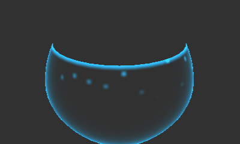

# Palimpsest（重写之卷）

一款单人 3D 第三人称动作游戏，结合环境时间线解谜。故事发生在 150 年后、被时空扭曲的墨尔本大学 Parkville 校区。本项目使用 Unity 6.3 开发、发布为 WebGL 网页版，由三人团队于 2026 年完成。

**▶ 在线试玩：** [yukijiang419.github.io/palimpsest-play](https://yukijiang419.github.io/palimpsest-play/)（建议使用桌面版 Chrome 或 Edge，首次加载约 95 MB）

**▶ 演示视频：** [YouTube](https://youtu.be/ODcsN_qIRAg)

## 游戏简介

一场空间档案事故让校园的过去、现在与未来版本重叠在一起。玩家扮演一名回收特工，需要：

- **击败残留体（Residues）**：由校园家具变成的敌人（爬行书桌、自动售货机、显微镜），每个都带有护盾。普通连招、冲刺斩、连续斩和远程审判斩都要消耗体力，和闪避共用同一份资源，需要取舍。
- **在压力下使用路径交互（Path Interaction）**：按住右键后时间变慢，目标身上展开一个 5×5 网格。玩家画出一条经过恢复、伤害、控制节点的路径，分别可以回血、击碎敌人护盾或定身敌人，而敌人在这期间仍会继续攻击。
- **解开时间线谜题**：三个没有敌人的独立区域。在“过去”推动建筑构件，就能在“未来”和“现在”重建楼梯、墙洞和桥梁。
- **击败打印机 Boss**：位于 Old Arts 的失控档案打印机，会召唤小怪波次、降下纸张雨、筑起纸墙包围玩家。

进度、武器、金币和商店升级在各场景之间保留，并自动保存到浏览器的 IndexedDB。

## 我的贡献（Xiaoqi Jiang）

- **敌人系统**：敌人行为、重力、霸体和小队数量调校；把原来的敌人替换成校园家具角色，并新增**打印机 Boss**。 
  代码：[`EnemyController.cs`](Assets/Scripts/Enemy/EnemyController.cs) · [`EnemySystem.cs`](Assets/Scripts/Enemy/EnemySystem.cs) · [`EnemyScanBeam.cs`](Assets/Scripts/Enemy/EnemyScanBeam.cs)
- **Boss 房**：搭建 Boss 竞技场场景，实现 Boss 战全流程（护盾阶段、小怪波次、纸张雨、纸墙环、近身重击）以及 Old Arts 入口。 
  代码：[`BossController.cs`](Assets/Scripts/Enemy/BossController.cs) · [`BossLaser.shader`](Assets/Shaders/BossLaser.shader) · [`PuzzleEntrance.cs`](Assets/Scripts/Puzzles/PuzzleEntrance.cs)
- **武器与经济系统**：双武器槽、四种武器变体；金币掉落与金币 HUD；商人 NPC 和跨解谜场景保留的升级商店；商店与 HUD 中的武器图标，以及按 `O` 打开的武器属性面板。 
  代码：[`WeaponManager.cs`](Assets/Scripts/Combat/WeaponManager.cs) · [`WeaponData.cs`](Assets/Scripts/Combat/WeaponData.cs) · [`CoinPickup.cs`](Assets/Scripts/Player/CoinPickup.cs) · [`PlayerWallet.cs`](Assets/Scripts/Player/PlayerWallet.cs) · [`Merchant.cs`](Assets/Scripts/NPC/Merchant.cs) · [`PlayerHudPresenter.cs`](Assets/Scripts/UI/HUD/PlayerHudPresenter.cs)
- **玩家角色**：优化移动和攻击动画的流畅度；把玩家模型换成绑定好骨骼的兜帽剑士。 
  代码：[`PlayerAnimator.cs`](Assets/Scripts/Player/PlayerAnimator.cs) · [`PlayerMoveController.cs`](Assets/Scripts/Player/PlayerMoveController.cs)
- **解谜体验**：解谜教程、实时提示栏和推箱子动画。 
  代码：[`PuzzleHintPresenter.cs`](Assets/Scripts/Puzzles/PuzzleHintPresenter.cs) · [`PuzzleBlockPusher.cs`](Assets/Scripts/Puzzles/PuzzleBlockPusher.cs)
- **护盾 shader**：在 HLSL 护盾 shader 上新增低护盾警告和基于噪声的破碎溶解效果（详见下文）。 
  代码：[`ShieldShader.shader`](Assets/Shaders/ShieldShader.shader) · [`ShieldVisual.cs`](Assets/Scripts/Combat/ShieldVisual.cs)
- **项目管理**：把资源文件夹控制在 250 MB 限制以内；维护游戏设计文档（GDD）；编写用户评估计划、问卷和评估报告。

### 护盾 Shader

源码：[ShieldShader.shader](Assets/Shaders/ShieldShader.shader) · 控制脚本：[ShieldVisual.cs](Assets/Scripts/Combat/ShieldVisual.cs)

护盾是一个叠加混合的外壳，边缘带菲涅尔光。外壳会按剩余护盾比例从高处裁切，裁切线是一条明亮的水位线，下方有水滴滑落。测试玩家反映很难看出护盾是否还在，所以我加了两种状态提示：

- **低护盾警告**：护盾低于 50% 时，边缘颜色用 `smoothstep` 从蓝色渐变到红色，30% 时完全变红；同时外壳会像接触不良的灯一样闪烁。闪烁是随时间采样值噪声，再锐化成开/关两种状态得到的。
- **破碎溶解**：护盾被击碎时，用两层 3D 值噪声在一秒内把外壳“烧掉”，烧蚀边缘会发光。护盾的保护在击碎那一刻就结束，不会等特效播完。

| 满护盾 | 低护盾警告 |
| --- | --- |
|  |  |

| 警告闪烁 | 破碎溶解 |
| --- | --- |
|  |  |

## 团队分工

| 成员 | 主要负责 |
| --- | --- |
| Binglin Li | 校园环境；菜单、HUD、对话和商店界面；任务与剧情呈现；目标锁定；音频整合；树木摆动和故障光照 shader |
| Yiming Zheng | 时间线谜题；剑技连招和特殊攻击；审判斩 shader 与粒子特效；宣传片 |
| Xiaoqi Jiang | 敌人与 Boss；Boss 房；武器、金币、商人与商店；玩家角色；护盾 shader |

## 仓库内容

本仓库用于展示代码，不是完整的 Unity 工程。

| 路径 | 内容 |
| --- | --- |
| [Assets/Scripts](Assets/Scripts) | C# 玩法代码：战斗、敌人与 Boss、路径交互（`Maze`）、解谜、任务、存档、界面 |
| [Assets/Shaders](Assets/Shaders) | HLSL shader：护盾、审判斩、树木摆动、故障光照等 |
| [Assets/Config](Assets/Config) | 玩法数值、武器和任务数据 |
| [Assets/Plugins/WebGL](Assets/Plugins/WebGL) | 浏览器存档（IndexedDB）和鼠标锁定的 JavaScript 桥接 |
| [docs/images](docs/images) | 截图和设计图 |

第三方美术、动画和音频**没有包含在本仓库中**，因为它们的许可证（Unity Asset Store EULA、Adobe Mixamo）不允许分发源文件，所以仅凭本仓库无法打开可游玩的场景。完整游戏请通过上方的在线试玩链接体验，或观看演示视频。

## 素材署名

- 玩家角色：Pigcraft，[White Hooded Assassin with Red Belt](https://sketchfab.com/3d-models/white-hooded-assassin-with-red-belt-c7ad4bc7b6d64df8a03243e9839939ac)，[CC BY 4.0](https://creativecommons.org/licenses/by/4.0/)；通过 Adobe Mixamo 绑定骨骼并做了修改
- 动画：Kevin Iglesias，[Human Melee Animations FREE](https://assetstore.unity.com/packages/3d/animations/human-melee-animations-free-165785)；Adobe Mixamo
- 商人角色：Adobe Mixamo
- 剑：BLINK，[FREE - Low Poly Swords](https://assetstore.unity.com/packages/3d/props/weapons/free-low-poly-swords-rpg-weapons-198166)；金币：Devtoid，[Gold Coins](https://assetstore.unity.com/packages/3d/props/gold-coins-1810)
- 音乐：SRG774，[Dark Sci-Fi Audio Pack](https://opengameart.org/content/dark-sci-fi-audio-pack)（CC0）；Blackvoid6，[Cyberpunk Action Music Pack](https://blackvoid6.itch.io/cyberpunk-action-music-pack)（CC BY 4.0）
- 音效：Kenney、marcelofg55、Ogrebane（CC0）
- 贴图与道具：Poly Haven、Quaternius、Kenney（CC0）
- 字体：Adobe Source Serif 4、IBM Plex（SIL OFL）
- 校园模型、敌人模型、部分界面美术以及部分代码和文档使用了 AI 辅助。

© 2026 Binglin Li、Yiming Zheng、Xiaoqi Jiang，保留所有权利。代码仅供作品展示浏览。
