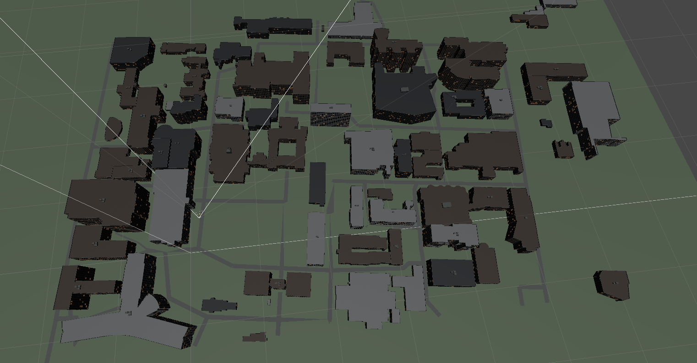
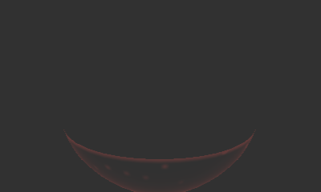
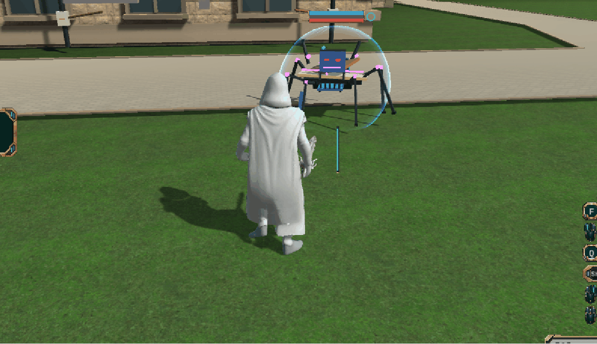
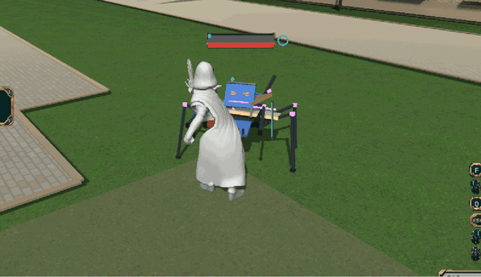
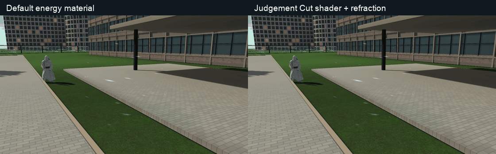

# Palimpsest

A single-player 3D third-person action game with environmental timeline puzzles, set on a distorted University of Melbourne Parkville campus 150 years in the future. Built in Unity 6.3 for WebGL by a team of three as the second project for COMP30019 Graphics and Interaction at the University of Melbourne (2026).

**▶ Play in the browser:** _link coming soon_

## The Game

A spatial archive accident has made past, present and future versions of the campus overlap. As a recovery operative, the player:

- **Fights Residues**: furniture-shaped enemies (Desk Crawlers, Vending Machines, Microscopes) protected by shields. Melee combos, Rush Slash, Rapid Cuts and a ranged Judgment Cut all trade off against stamina used for dodging.
- **Uses Path Interaction under pressure**: holding right-click slows time and opens a 5×5 grid on the target. Drawing a path through Recovery, Damage and Control nodes heals the player, strips the enemy's shield or binds it, while enemies keep attacking.
- **Solves timeline puzzles**: three enemy-free areas where pushing construction blocks in the Past rebuilds stairs, walls and bridges in the Future and Present.
- **Defeats the Printer Boss**: a corrupted archive printer in Old Arts, with summoned minion waves, paper-rain and paper-wall attacks.

Progress, weapons, coins and shop upgrades persist across scenes and are saved to the browser's IndexedDB.

## My Contributions (Xiaoqi Jiang)

- **Enemy system**: enemy behaviour, gravity, swing armour and squad tuning. Replaced the original enemies with the campus-furniture characters and added the **Printer Boss**.
- **Boss Room**: built the Boss arena scene, the Boss fight (shield phase, minion waves, paper rain, paper-wall ring, close-range slam) and the Old Arts entrance.
- **Weapons and economy**: weapon system with two slots and four weapon variants, coin drops and coin HUD, the merchant NPC and the upgrade shop that persists across puzzle scenes, weapon icons and an `O`-key stats panel.
- **Player character**: smoothed movement and attack animation; replaced the player body with the rigged Hooded Swordsman.
- **Puzzle UX**: puzzle tutorial, live hint bar and block-pushing animation.
- **Shield shader**: extended an HLSL shield shader with a low-shield warning and a noise-based break dissolve (details below).
- **Production**: kept the project under the 250 MB asset limit, maintained the game design document, and wrote the user-evaluation plan, questionnaire and evaluation report.

### Shield Shader

Source: [ShieldShader.shader](Assets/Shaders/ShieldShader.shader) · Controller: [ShieldVisual.cs](Assets/Scripts/Combat/ShieldVisual.cs)

The shield is an additive shell with a Fresnel rim, clipped at a height equal to the remaining shield, with a bright waterline and sliding droplets. Playtesters found it hard to tell whether a shield was still active, so I added two state cues:

- **Low-shield warning**: below 50% the rim blends from blue to red (fully red at 30%) using `smoothstep`, and the shell flickers like a failing light. The flicker samples value noise over time and sharpens it into on/off steps.
- **Break dissolve**: when the shield breaks, two layers of 3D value noise burn the dome away over one second with a glowing edge. Gameplay protection ends at the moment of the break, not after the effect.

| Full shield | Low-shield warning |
| --- | --- |
|  |  |

| Warning flicker | Break dissolve |
| --- | --- |
|  |  |

## Team

| Member | Main areas |
| --- | --- |
| Binglin Li | Campus environment, menus/HUD/dialogue/shop UI, quests and story presentation, target lock, audio integration, Tree Wind and glitch-lighting shaders |
| Yiming Zheng | Timeline puzzles, sword combos and special attacks, Judgment Cut shader and particle effects, trailer |
| Xiaoqi Jiang | Enemies and Boss, Boss Room, weapons, coins, merchant and shop, player character, shield shader |

## Repository Contents

This repository is a code showcase, not the complete Unity project.

| Path | Contents |
| --- | --- |
| [Assets/Scripts](Assets/Scripts) | C# gameplay code: combat, enemies and Boss, Path Interaction (`Maze`), puzzles, quests, persistence, UI |
| [Assets/Shaders](Assets/Shaders) | HLSL shaders: shield, Judgment Cut, tree wind and glitch lighting |
| [Assets/Config](Assets/Config) | Gameplay tuning, weapon and quest data |
| [Assets/Plugins/WebGL](Assets/Plugins/WebGL) | Browser save (IndexedDB) and pointer-lock bridges |
| [docs/images](docs/images) | Screenshots and design images |

Third-party art, animation and audio are **not included** because their licences (Unity Asset Store EULA, Adobe Mixamo) do not allow redistribution of source files, so the project will not open as a playable scene from this repository alone. The browser build above contains the full game.

## Credits

- Player character: Pigcraft, [White Hooded Assassin with Red Belt](https://sketchfab.com/3d-models/white-hooded-assassin-with-red-belt-c7ad4bc7b6d64df8a03243e9839939ac), [CC BY 4.0](https://creativecommons.org/licenses/by/4.0/); rigged through Adobe Mixamo and modified
- Animations: Kevin Iglesias, [Human Melee Animations FREE](https://assetstore.unity.com/packages/3d/animations/human-melee-animations-free-165785); Adobe Mixamo
- Merchant character: Adobe Mixamo
- Swords: BLINK, [FREE - Low Poly Swords](https://assetstore.unity.com/packages/3d/props/weapons/free-low-poly-swords-rpg-weapons-198166); coins: Devtoid, [Gold Coins](https://assetstore.unity.com/packages/3d/props/gold-coins-1810)
- Music: SRG774, [Dark Sci-Fi Audio Pack](https://opengameart.org/content/dark-sci-fi-audio-pack) (CC0); Blackvoid6, [Cyberpunk Action Music Pack](https://blackvoid6.itch.io/cyberpunk-action-music-pack) (CC BY 4.0)
- Sound effects: Kenney, marcelofg55 and Ogrebane (CC0)
- Textures and props: Poly Haven, Quaternius and Kenney (CC0)
- Fonts: Adobe Source Serif 4 and IBM Plex (SIL OFL)
- AI assistance was used for the campus model, enemy models, selected UI artwork and parts of the code and documentation.

© 2026 Binglin Li, Yiming Zheng and Xiaoqi Jiang. All rights reserved. The code is published for portfolio viewing only.
